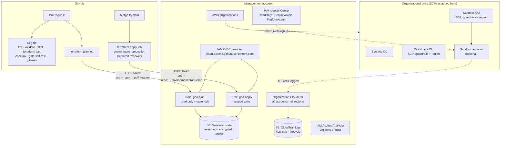

# aws-iam-guardrails

[](https://github.com/dardan-hoxhaj/aws-iam-guardrails/actions/workflows/ci.yml)

Terraform for a small AWS organization with identity and security guardrails built in:
Organizations + Service Control Policies, IAM Identity Center for people, GitHub Actions
OIDC roles for pipelines (no stored AWS keys), an organization CloudTrail, IAM Access
Analyzer, and a CI gate that blocks risky IAM changes before they merge.

> **Status, stated plainly.** Everything in this repo is checked in CI on every push:
> formatting, validation, linting, unit tests with a mocked AWS provider, a security
> scan, a self-test that proves the scan blocks risky IAM, and a secret scan.
> **It has not been applied to a real AWS account yet.** Sections marked
> `TODO(apply)` get filled in from a real run. See [What is validated](#what-is-validated-and-what-is-not).

## The problem

Most AWS security incidents start with identity: a leaked long-lived access key, an
admin role any pipeline can assume, someone turning off logging, or a resource shared
outside the company by mistake. Teams need guardrails that:

1. **Cannot be removed by an account admin** (preventive controls).
2. **Give people and pipelines only short-lived credentials** (no keys to leak).
3. **Record every API call** so an `AccessDenied` or a suspicious change can be traced.
4. **Stop risky IAM before it is deployed**, in code review, not after.

## Architecture



### What each piece does

| Piece | What it is (plain words) | Where |
|---|---|---|
| **AWS Organizations** | Groups AWS accounts under one *management* account so policies and logging apply to all of them. | `modules/organization` |
| **SCP** (Service Control Policy) | A ceiling on what *any* identity in a member account can do, even its admins. It never grants, only limits. | `modules/scps` |
| **IAM Identity Center** | Single sign-on for AWS. People sign in once and get credentials that expire. A **permission set** is a named bundle of permissions (a job role). | `modules/identity-center` |
| **GitHub OIDC roles** | GitHub proves "I am job X in repo Y" with a signed token; AWS swaps it for 1-hour credentials. No AWS keys live in GitHub. | `bootstrap/github_oidc.tf` |
| **CloudTrail** | The log of every AWS API call: who, what, when, from where, and whether it was denied. | `modules/cloudtrail` |
| **IAM Access Analyzer** | Reads resource policies and flags anything shared with a principal outside the organization. | `modules/access-analyzer` |
| **CI gate** | Checks that must pass before a pull request can merge. | `.github/workflows/ci.yml` |

### The guardrail SCPs

Attached to the **Workloads** and **Sandbox** OUs, not to the organization root, so a
mistake in a policy can only affect accounts you deliberately moved into those OUs.

| SCP | Statement | Why |
|---|---|---|
| `guardrails` | `DenyLeavingOrganization` | An account that leaves the org escapes every guardrail. |
| | `ProtectAuditTrail` | Attackers turn off logging first. Nobody in a member account can stop or edit the trail. |
| | `ProtectAccessAnalyzer` | Keeps external-access findings coming. |
| | `DenyMemberAccountRootUser` | Root has no permission limits; people use Identity Center instead. |
| | `DenyLongLivedIamUserKeys` | Blocks `iam:CreateUser` and `iam:CreateAccessKey`. Long-lived keys are the most commonly leaked AWS secret. |
| | `KeepEbsEncryptionOn` | Default disk encryption cannot be switched off. |
| `region-restriction` | `DenyOutsideAllowedRegions` | Regional calls outside `allowed_regions` are denied. Global services (IAM, STS, Organizations, billing, support, …) are exempt via `NotAction`. |

Important: **SCPs never restrict the management account.** That is why the project can
create an optional sandbox member account for testing (`create_sandbox_account`).

### Least-privilege CI roles

| Role | Who can assume it (trust policy `sub`) | What it can do |
|---|---|---|
| `gha-plan` | `repo:<owner>/aws-iam-guardrails:pull_request` only | Read the services this stack manages, read state, and create/delete **only** the `.tflock` lock file. |
| `gha-apply` | `repo:<owner>/aws-iam-guardrails:environment:production` only | Write actions listed one by one per service; IAM writes limited to Identity Center role paths; S3/CloudTrail/Access Analyzer limited to this project's ARNs. |

The `production` environment has a required reviewer, so nothing is applied without a
human clicking approve. Pull requests from forks never get AWS credentials.

## Repository layout

```
bootstrap/                 Run once from your laptop: state bucket + OIDC provider + CI roles
  tests/                   terraform test: trust policies are exact, no wildcards
live/                      The guardrails stack (applied by CI after bootstrap)
  tests/                   terraform test: SCPs hit OUs not the root, assignments wire up
modules/
  organization/            Organization, OUs, optional sandbox account
  scps/                    SCP documents + attachments
    tests/                 terraform test: size limit, deny-only, region list
  identity-center/         Permission sets, groups, account assignments
  cloudtrail/              Organization trail + hardened log bucket
  access-analyzer/         Org-wide external access analyzer
tests/gate-fixtures/       Deliberately risky IAM; CI proves checkov rejects it
scripts/gate-selftest.sh
docs/
  deploy.md                Step-by-step: budget alert to teardown
  runbooks/accessdenied-cloudtrail.md
  design-decisions.md      Why each choice was made (interview prep)
```

## How to run

### Checks only (no AWS account needed)

```bash
brew install terraform tflint checkov gitleaks pre-commit
pre-commit install      # gitleaks + fmt + tflint on every commit
make check              # same checks CI runs
```

### Deploy to AWS

Follow **[docs/deploy.md](docs/deploy.md)**. Short version:

0. **AWS Budgets alert first**, before any resource exists.
1. Enable IAM Identity Center in the console and give yourself a temporary admin sign-in.
2. Install the AWS CLI and log in with `aws sso login`.
3. `bootstrap/`: one local `terraform apply` creates the state bucket and the two CI roles.
4. `live/`: import the organization Identity Center created, then the first `terraform apply`.
5. Put the role ARNs and bucket name into GitHub settings, protect the `production` environment.
6. From now on: pull request → plan; merge → approve → apply.

## Cost and teardown

| Resource | Cost |
|---|---|
| AWS Organizations, SCPs, OUs | Free |
| IAM Identity Center, permission sets, groups | Free |
| IAM roles, OIDC provider | Free |
| IAM Access Analyzer (external access) | Free. *Unused access* analysis is paid and is **not** enabled. |
| CloudTrail organization trail (first copy of management events) | Free |
| S3 (state + CloudTrail logs, 90-day expiry) | A few cents a month at demo volume |
| Sandbox member account | Free, but closing an account takes up to 90 days to finish |

Not enabled on purpose because they cost money: customer-managed KMS keys (~$1/key/month),
CloudTrail → CloudWatch Logs delivery, data events, GuardDuty, AWS Config.

Teardown, and commands that prove nothing is left running, are in
[docs/deploy.md → Teardown](docs/deploy.md#teardown).

<!-- TODO(apply): after your first month, replace the estimate above with the real number from Cost Explorer. -->

## What is validated and what is not

| Check | Runs in CI | What it proves |
|---|---|---|
| `terraform fmt -check` | ✅ | Code is formatted. |
| `terraform validate` (all stacks and modules) | ✅ | Syntax, types, references and provider schemas are correct. |
| `tflint` (+ AWS ruleset) | ✅ | No unused declarations, every variable/output documented, naming conventions, AWS-specific mistakes. |
| `terraform test` (15 tests, mocked AWS) | ✅ | OIDC trust is exact with no wildcards; SCPs stay under 5,120 chars, only deny, use the allowed regions; SCPs attach to OUs not the root; Identity Center assignments wire up with and without a sandbox; bad inputs are rejected. |
| `checkov` (Terraform + GitHub Actions) | ✅ | No unjustified security findings. Every skip is inline with a written reason (`grep -rn checkov:skip`). |
| Gate self-test | ✅ | `checkov` **fails** on `tests/gate-fixtures/risky-iam` (an `*:*` admin policy and an OIDC trust open to any repo). If it ever passes, CI fails. |
| `gitleaks` (full history) | ✅ | No secrets in any commit. |
| Real `terraform apply` in AWS | ❌ not yet | `TODO(apply)` |
| CI roles have *exactly* enough permission | ❌ not yet | First real plan/apply may hit `AccessDenied` for an action I missed. That is what the [runbook](docs/runbooks/accessdenied-cloudtrail.md) is for. |
| SCP AccessDenied drill | ❌ not yet | `TODO(apply)` |

Mocked tests check **this project's logic** (names, wiring, policy contents). They do not
prove AWS will accept every call, which only a real apply shows.

## Production support: tracing an AccessDenied

[docs/runbooks/accessdenied-cloudtrail.md](docs/runbooks/accessdenied-cloudtrail.md) walks
through a deliberate failure: call a denied API from the sandbox account, read the error,
find the event in CloudTrail, decide whether it is an SCP (explicit deny) or a missing
permission (implicit deny), and fix or confirm it.

## Found during the build

- **`for_each` keyed on account IDs breaks the first apply.** Identity Center assignments
  were first keyed by account ID. The `live` unit test failed with *"Invalid for_each
  argument"*, because a new account's ID is unknown until apply. Fixed by keying on account
  **labels** (`management`, `sandbox`) and passing IDs as values. The test now guards it.
- **`checkov` silently skipped the risky fixture.** The gate self-test first passed for the
  wrong reason: `checkov` loaded the repo's `.checkov.yaml`, which skips the fixture folder.
  The script now runs from inside the fixture folder and checks that the expected check IDs fire.

<!-- TODO(apply): add what broke during your real apply and how you fixed it, with the error text. -->

## Screenshots

<!-- TODO(apply): add these after a real run. Blur account IDs and emails.
1. GitHub Actions: ci workflow green on a PR.
2. GitHub Actions: a PR that adds "*" to an IAM policy, blocked by checkov.
3. GitHub Actions: apply job waiting for production approval.
4. AWS Organizations console: OUs with SCPs attached.
5. The AccessDenied error in your terminal ("explicit deny in a service control policy").
6. CloudTrail Event history showing that event with its errorCode.
7. Identity Center: permission sets and groups.
-->

## What's next

- **Tighten the CI roles from real activity.** After a few runs, use IAM Access Analyzer
  *policy generation* on CloudTrail logs to produce a policy with only the actions actually used.
- **Delegated administrator.** Move Identity Center and Access Analyzer administration to a
  dedicated Security account so day-to-day work never needs the management account.
- **Query logs with Athena** over the CloudTrail S3 bucket instead of 90-day Event history.
- **KMS-encrypt** the CloudTrail and state buckets, and add S3 access logging.
- **Permissions boundaries** for any roles that workloads create.
- **Policy-as-code tests** for SCPs with real IAM policy simulation in a sandbox account.

## License

MIT
